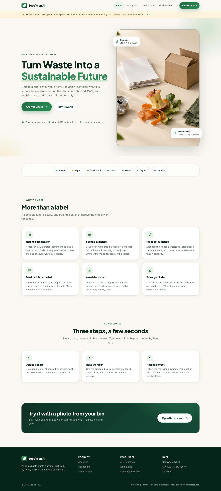
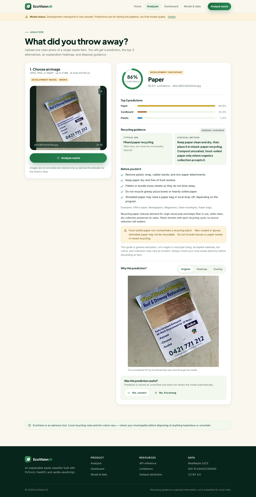
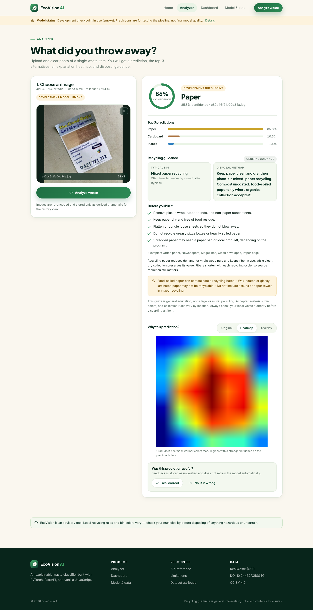
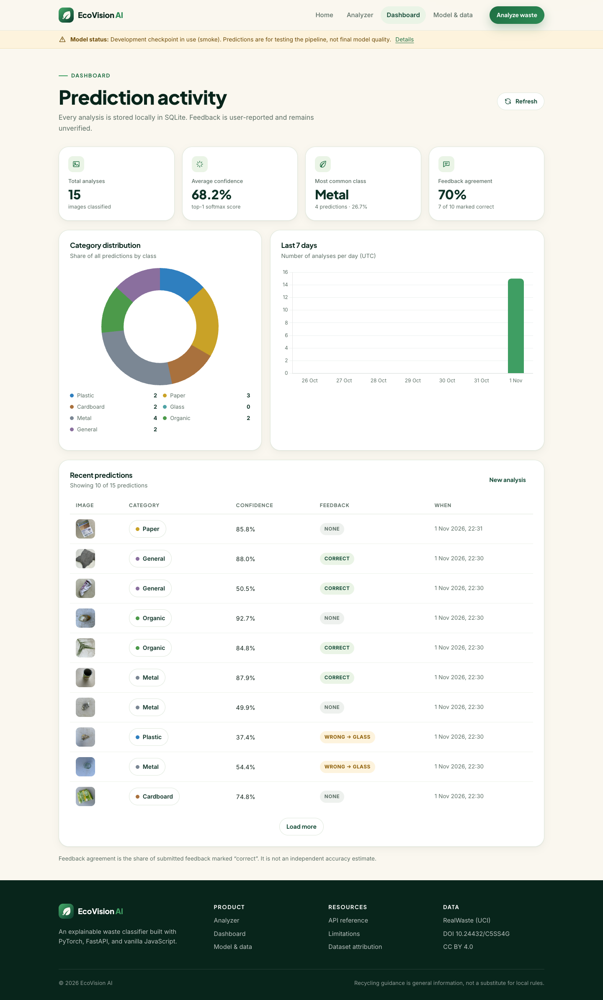
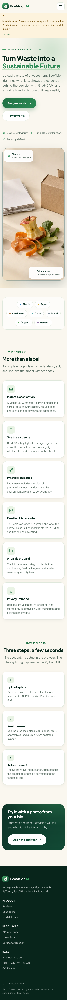
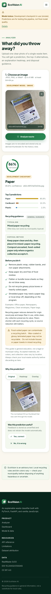
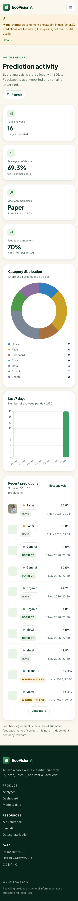
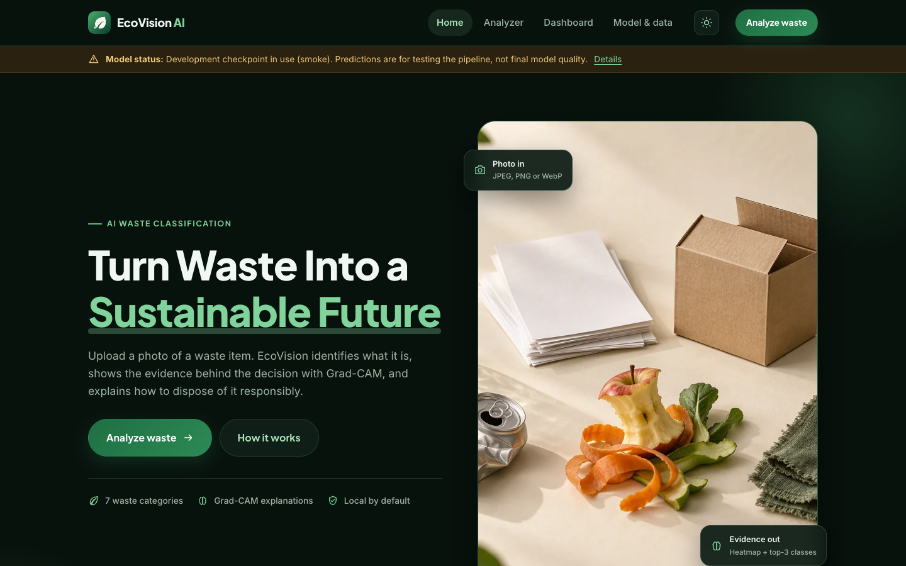
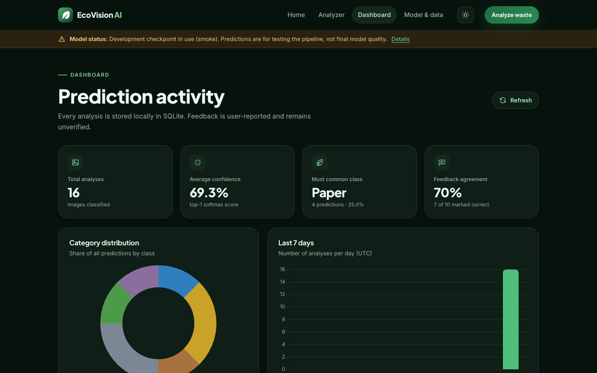

# EcoVision AI — Smart Waste Classification & Recycling Assistant

EcoVision AI is an end-to-end deep learning application that classifies a photo of a waste item into one of seven categories, explains the prediction with Grad-CAM, and returns practical recycling guidance. It ships with a real training pipeline, leakage-safe evaluation, a FastAPI backend, a responsive vanilla-JavaScript frontend, tests, Docker packaging, and a Google Colab notebook for final GPU training.



> **Honest status:** the repository currently contains a **development smoke checkpoint** trained on a small stratified subset. Its metrics validate the pipeline and make the app demoable — they are **not** final results. `ml/notebooks/EcoVision_Training_Colab.ipynb` runs the full training on a GPU; `ml/scripts/install_artifacts.py` validates and installs the returned artifacts, after which the app reports `is_final: true` and displays the real held-out metrics.

---

## Problem

Waste sorting is error-prone: recyclable material is landfilled because it is contaminated, and non-recyclable material clogs recycling streams. A photo-based classifier that also explains *why* it made a decision and what to do next can help households and facility staff make better disposal choices. EcoVision AI addresses that workflow end-to-end rather than stopping at a notebook accuracy number.

## Features

- **7-class classification** — Plastic, Paper, Cardboard, Glass, Metal, Organic, General.
- **Two real architectures** — a from-scratch custom CNN baseline and a fine-tuned MobileNetV2.
- **Transparent predictions** — top-3 probabilities, confidence thresholding, and a warning when the model is unsure.
- **Grad-CAM explanations** — original, heatmap, and overlay images generated from the last convolutional stage.
- **Recycling assistant** — disposal method, bin type, preparation steps, environmental impact, cautions, and sources, with a clear “check local rules” disclaimer.
- **Feedback loop** — mark a prediction correct/incorrect, supply the corrected class and a comment; feedback is stored (not used for automatic retraining).
- **Prediction history and dashboard** — SQLite persistence, aggregate statistics, category distribution, 7-day activity, and recent predictions with thumbnails.
- **Responsive UI** — four pages (landing, analyzer, dashboard, model & data), mobile-first layout, keyboard-accessible upload, reduced-motion support.
- **Light and dark themes** — header toggle with system-preference default, persisted choice, no flash of the wrong theme, and charts that re-color on switch.
- **Operational readiness** — request IDs, consistent error envelopes, upload validation, degraded-mode startup when no checkpoint is installed, health checks, and Docker packaging.

## Screenshots

| Analyzer | Grad-CAM | Dashboard |
|---|---|---|
|  |  |  |

| Landing (mobile) | Analyzer (mobile) | Dashboard (mobile) |
|---|---|---|
|  |  |  |

| Landing (dark) | Dashboard (dark) |
|---|---|
|  |  |

The banner in these screenshots is intentional: the active checkpoint is a smoke model.

## Architecture

```
┌──────────────────────────────────────────────────────────────────┐
│ Frontend (vanilla HTML/CSS/JS, ES modules, vendored Chart.js)     │
│  index.html · analyzer.html · dashboard.html · about.html        │
└───────────────┬──────────────────────────────────────────────────┘
                │ fetch JSON / multipart image
┌───────────────▼──────────────────────────────────────────────────┐
│ FastAPI (backend/main.py)                                        │
│  /api/predict  /api/feedback  /api/history  /api/statistics      │
│  /api/model-info  /api/health  ·  /media/<id> static files       │
│                                                                  │
│  ModelService ── checkpoint → architecture → Grad-CAM            │
│  Image validation → 512 px derived media → SQLite (WAL)          │
└───────────────┬──────────────────────────────────────────────────┘
                │ shared code (no preprocessing duplication)
┌───────────────▼──────────────────────────────────────────────────┐
│ ml/ — training, evaluation, serving share this package           │
│  classes.py · transforms.py · data.py · artifacts.py             │
│  architectures/{custom_cnn,mobilenet_v2}.py · gradcam.py         │
└───────────────┬──────────────────────────────────────────────────┘
                │
      RealWaste dataset (UCI 908) → leakage-safe splits → checkpoints
```

Why the ML package lives outside `backend/`: training and serving import the same class order, transforms, architectures, and Grad-CAM implementation, so preprocessing cannot drift between evaluation and production.

## Models

| | Custom CNN | MobileNetV2 |
|---|---|---|
| Approach | From scratch | ImageNet pretrained, staged fine-tuning |
| Parameters | 1,175,015 | 2,232,839 |
| Input | 224 × 224 RGB | 224 × 224 RGB |
| Body | 4 conv blocks (32/64/128/256), BN + ReLU, max-pool | MobileNetV2 inverted residuals |
| Head | GAP → Dropout 0.4 → Linear(7) | Dropout 0.3 → Linear(1280→7) |
| Training | AdamW, cosine schedule, label smoothing 0.1 | Stage A frozen head, Stage B last 3 blocks with frozen BN |
| Selection | Validation macro-F1 | Validation macro-F1 |
| Grad-CAM layer | Final conv block | `features[-1]` |

The checkpoints store a plain state dict plus metadata (`arch`, canonical `class_names`, `input_size`, `stage`, `split_hash`, `history`, `extra`) and are loaded with `weights_only=True`.

## Dataset

[RealWaste](https://archive.ics.uci.edu/dataset/908/realwaste) — 4,752 real landfill photographs (524 × 524 JPG) collected at the Whyte's Gully landfill, Wollongong, Australia.

- **License:** CC BY 4.0
- **DOI:** [10.24432/C5SS4G](https://doi.org/10.24432/C5SS4G)
- **Citation:** Single, S., Iranmanesh, S., & Raad, R. (2023). *RealWaste: A Novel Real-Life Data Set for Landfill Waste Classification Using Deep Learning.* Information, 14(12), 633.

The nine source classes are mapped to the seven product classes:

| Target class | RealWaste source classes | Images |
|---|---|---:|
| Plastic | Plastic | 921 |
| Paper | Paper | 500 |
| Cardboard | Cardboard | 461 |
| Glass | Glass | 420 |
| Metal | Metal | 790 |
| Organic | Food Organics + Vegetation | 847 |
| General | Miscellaneous Trash + Textile Trash | 813 |
| **Total** | | **4,752** |

`Textile Trash → General` is a documented judgment call: textiles are rarely accepted in curbside recycling. The mapping lives in [`ml/dataset_meta.json`](ml/dataset_meta.json) and is surfaced through `/api/model-info`.

## Methodology

1. **Download and inspection** — streamed download with size limits, safe extraction, recursive image discovery, and a class-count gate against `dataset_meta.json`.
2. **Leakage-safe splits** — SHA-256 for exact duplicates and 64-bit dHash union-find groups (Hamming distance ≤ 5) so near-duplicate video frames cannot straddle train/validation/test. Group-aware stratified 70/15/15 split, seed 42.
3. **Augmentation** — `RandomResizedCrop(224, scale 0.7–1.0)`, horizontal flip, ±15° rotation, color jitter, ImageNet normalization, light random erasing. Evaluation uses resize 256 → center crop 224.
4. **Class imbalance** — class-weighted cross-entropy with capped weights; macro-F1 is the model-selection metric because it treats all seven classes equally.
5. **Training** — Custom CNN: AdamW, cosine schedule, early stopping. MobileNetV2: frozen-backbone head training then fine-tuning of the last three inverted-residual blocks with a lower backbone learning rate and frozen batch-norm statistics.
6. **Evaluation** — the held-out test split is evaluated **once**. Reports include accuracy, macro/weighted precision/recall/F1, per-class metrics, confusion matrices, training curves, parameter counts, checkpoint size, and CPU latency.
7. **Explanation** — manual Grad-CAM (no third-party Grad-CAM dependency) with forward hooks, lock-protected for concurrent API requests and removed in `finally`.

## Results

### Final held-out results — pending Colab training

No final metrics exist yet. Run the Colab notebook (below) on a T4 GPU, then install the artifact zip. `install_artifacts.py` verifies both checkpoints declare `stage: final`, class order matches the app, the manifest points at an installed model, and `metrics.json` contains both models plus the comparison table before copying anything. The README and About page are then updated from the generated files — never hand-written.

### Smoke run — pipeline validation only

These numbers come from the **development smoke checkpoint**: a small stratified subset, 3 epochs, and a 420-image balanced test subset (60 per class). They exist to prove the pipeline is real and the app is demoable. **Do not cite them as model quality.**

| Model | Parameters | Checkpoint | Accuracy | Macro F1 | CPU latency | Training time |
|---|---:|---:|---:|---:|---:|---:|
| Custom CNN | 1,175,015 | 4.5 MB | 0.488 | 0.457 | 29.4 ms | 2.6 min |
| MobileNetV2 | 2,232,839 | 8.7 MB | 0.700 | 0.695 | 23.8 ms | 1.8 min |

Grad-CAM samples from the smoke model are in [`ml/evaluation/smoke/gradcam_samples/`](ml/evaluation/smoke/gradcam_samples). The final run writes to `ml/evaluation/final/`.

## Quick start

### Prerequisites

- macOS or Linux, 8 GB RAM recommended (CPU inference works; training is slow)
- [uv](https://docs.astral.sh/uv/) for the Python 3.12 environment
- ~1.5 GB free disk for the dataset and cached images
- Optional: Docker / Colima for containerized deployment
- Optional: a Google account for Colab final training

### 1. Environment

```bash
cd ecovision-ai
make setup          # uv python 3.12, .venv, requirements-dev.txt
cp .env.example .env
```

### 2. Dataset and splits

```bash
make download       # RealWaste archive from UCI; add --source hf for the resumable mirror
make prepare        # hashes, duplicate groups, 70/15/15 splits, 256 px cache
```

### 3. Train locally (smoke, real data)

```bash
make smoke          # MobileNetV2 smoke, Custom CNN smoke, test-split evaluation
```

Artifacts are written to `ml/models/smoke/` and `ml/evaluation/smoke/`. The manifest activates the MobileNetV2 smoke checkpoint. This is a genuine training run on real images — just a small, fast one.

### 4. Run the app

```bash
make serve
```

- App: <http://127.0.0.1:8000/> (`/analyzer.html`, `/dashboard.html`, `/about.html`)
- Interactive API docs: <http://127.0.0.1:8000/docs>
- Health: <http://127.0.0.1:8000/api/health>

The app starts in degraded mode if no checkpoint is installed; `/api/predict` returns `503 MODEL_UNAVAILABLE` instead of fabricating a prediction.

### 5. Tests

```bash
make test           # pytest -q
```

The suite covers health and model loading, image validation (format, size, corruption, animation, decompression bombs), prediction contracts, feedback upsert, history pagination, statistics, split integrity, frontend asset/API contracts, and an integration test that runs against the real smoke checkpoint when present.

## Final training on Google Colab

1. Upload a zip of the project (without `.venv`, `ml/datasets`, and trained weights) or set `REPO_URL` in the notebook.
2. Open [`ml/notebooks/EcoVision_Training_Colab.ipynb`](ml/notebooks/EcoVision_Training_Colab.ipynb) in Colab and select a GPU runtime.
3. Run all cells. It downloads and prepares RealWaste, trains MobileNetV2 (4 + 12 epochs) and the custom CNN (up to 30), evaluates the test split once, generates Grad-CAM samples, and downloads `ecovision_final_artifacts.zip`.
4. Install and restart:

```bash
python ml/scripts/install_artifacts.py ~/Downloads/ecovision_final_artifacts.zip
make serve
```

Expected Colab runtime on a T4: roughly 25–40 minutes for MobileNetV2 and 15–25 minutes for the custom CNN, plus dataset download/preparation.

The installer rejects smoke checkpoints renamed as final, class-order mismatches, missing architectures, and malformed metrics with a clear error message.

## API

| Method | Path | Purpose |
|---|---|---|
| POST | `/api/predict` | Multipart image → validation → inference → top-3, advice, Grad-CAM URLs, persistence |
| POST | `/api/feedback` | Correct/incorrect verdict, optional corrected class and comment; upsert per prediction |
| GET | `/api/history?limit=&offset=` | Paginated predictions with thumbnails and feedback |
| GET | `/api/statistics` | Totals, class distribution, average confidence, feedback summary, 7-day trend |
| GET | `/api/model-info` | Active architecture, parameters, dataset mapping, metrics, limitations |
| GET | `/api/health` | API/model/database status, device, uptime, versions |

Errors use a consistent envelope:

```json
{
  "error": {
    "code": "FILE_TOO_LARGE",
    "message": "Images must be 8 MB or smaller.",
    "detail": null,
    "request_id": "2f6c1a9b7d4e0c31"
  }
}
```

Full request/response examples: [`docs/API.md`](docs/API.md).

## Configuration

All settings use the `ECOVISION_` prefix and can live in `.env`:

| Variable | Default | Notes |
|---|---|---|
| `ECOVISION_MODEL_PATH` | empty | Explicit checkpoint; skips remote download and manifest resolution |
| `ECOVISION_MODEL_DIR` | `ml/models` | Manifest + checkpoints (must be writable for remote installs) |
| `ECOVISION_EVALUATION_DIR` | `ml/evaluation` | Where `metrics.json` is read from and installed |
| `ECOVISION_DEVICE` | `cpu` | `cpu`, `cuda`, or `mps` |
| `ECOVISION_DATA_DIR` | `data` | Runtime root; SQLite + media live here |
| `ECOVISION_DB_PATH` | `$DATA_DIR/ecovision.db` | Optional explicit database path |
| `ECOVISION_UPLOAD_DIR` | `$DATA_DIR/uploads` | Optional explicit media path |
| `ECOVISION_MAX_UPLOAD_MB` | `8` | Hard upload cap |
| `ECOVISION_MAX_CONCURRENT_INFERENCE` | `2` | Inference semaphore |
| `ECOVISION_SERVE_FRONTEND` | `true` | Set `false` for separate deployments |
| `ECOVISION_FRONTEND_DIR` | `frontend` | Static frontend root |
| `ECOVISION_ALLOWED_ORIGINS` | `*` | Comma-separated origin list in production |
| `ECOVISION_LOG_LEVEL` | `INFO` | Uvicorn/app log level |
| `ECOVISION_APP_ENV` | `development` | Reported by `/api/health` |
| `ECOVISION_HF_REPO` | empty | Hugging Face model repo, e.g. `user/ecovision-ai`; empty disables downloading |
| `ECOVISION_HF_FILENAME` | `mobilenet_v2_final.pt` | Checkpoint path inside the repo |
| `ECOVISION_HF_MANIFEST_FILENAME` | `model_manifest.json` | Optional manifest inside the repo |
| `ECOVISION_HF_METRICS_FILENAME` | `metrics.json` | Optional metrics inside the repo |
| `ECOVISION_HF_TOKEN` | empty | Read token for a private model repo |
| `ECOVISION_FETCH_MODEL` | `true` | Set `false` to skip the startup download |

Checkpoint resolution order: `ECOVISION_MODEL_PATH` → manifest `active` → final MobileNetV2 → final Custom CNN → smoke MobileNetV2 → smoke Custom CNN. The checkpoint's embedded `stage` is authoritative; a downloaded smoke checkpoint is never relabeled as final.

## Docker

```bash
docker build -t ecovision-ai .
docker compose up --build
```

The container listens on `0.0.0.0` and reads `PORT` (default `10000`), so Compose maps it to <http://localhost:8000/>. The image uses CPU-only PyTorch wheels (Python 3.12), runs as a non-root user, and exposes a health check. Compose mounts `ml/models` and `ml/evaluation` read-only and `data/` for persistence; remove the read-only flag if you want the container to download artifacts from Hugging Face locally. See [`docs/DEPLOYMENT.md`](docs/DEPLOYMENT.md) for separate frontend/API hosting, persistent disks, CORS, and scaling caveats.

## Deploy to Render (free tier)

The repository includes [`render.yaml`](render.yaml), a Blueprint for a Docker web service on Render's free plan. FastAPI serves both the API and the static frontend, so there is no second service or CORS setup. Model weights and datasets stay out of git; the container downloads the checkpoint from Hugging Face at startup.

### 1. Push the project to GitHub

```bash
git add -A
git status --short          # confirm no .pt, .db, or .env files are staged
git commit -m "Prepare Render deployment"
git branch -M main
git remote add origin https://github.com/<your-user>/ecovision-ai.git   # skip if already set
git push -u origin main
```

### 2. Publish the checkpoint to Hugging Face

Create a model repository (public, or private if you prefer) and upload the checkpoint plus optional manifest and metrics:

```bash
pip install -U huggingface_hub
hf auth login                 # huggingface-cli login on older releases
hf repo create <your-user>/ecovision-ai --repo-type model

hf upload <your-user>/ecovision-ai ml/models/mobilenet_v2_final.pt mobilenet_v2_final.pt
hf upload <your-user>/ecovision-ai ml/models/model_manifest.json model_manifest.json
hf upload <your-user>/ecovision-ai ml/evaluation/final/metrics.json metrics.json
```

The manifest and metrics uploads are optional. The checkpoint's embedded `stage` field is authoritative, so a smoke checkpoint stays labeled smoke even if the manifest says otherwise. If only smoke artifacts exist, upload them under their real name and set `ECOVISION_HF_FILENAME=smoke/mobilenet_v2_smoke.pt` — never rename smoke weights to `final`.

### 3. Create the Render service

1. In Render: **New → Blueprint**, connect the GitHub repository, and apply `render.yaml`.
2. Alternatively: **New → Web Service → Docker**, choose the repository, plan **Free**, and set the health check path to `/api/health`.
3. Provide the environment variables below when prompted.

| Render setting | Value |
|---|---|
| Runtime | Docker (`./Dockerfile`) |
| Plan | Free |
| Health check path | `/api/health` |
| `ECOVISION_HF_REPO` | `<your-user>/ecovision-ai` (leave empty only for degraded mode) |
| `ECOVISION_HF_FILENAME` | `mobilenet_v2_final.pt` |
| `ECOVISION_HF_TOKEN` | read token, only for a private model repo |
| `ECOVISION_APP_ENV` | `production` |
| `ECOVISION_DATA_DIR` | `/app/data` (already set in the image) |
| `PORT` | Injected by Render — do not set it manually |

`ECOVISION_MODEL_PATH` takes precedence over the Hugging Face download when you want to point the container at a specific checkpoint.

### 4. Verify the deployment

```bash
curl -fsS https://<service>.onrender.com/api/health
curl -fsS https://<service>.onrender.com/api/model-info
open https://<service>.onrender.com/            # landing page
open https://<service>.onrender.com/docs        # OpenAPI docs
```

`/api/health` reports `status: "ok"` and the loaded stage when a checkpoint is installed. If the download fails or no repository is configured, the service still boots with `status: "degraded"`, the existing banner appears, and `/api/predict` returns `503 MODEL_UNAVAILABLE` — it never fabricates a prediction.

### Free-tier storage and cold starts

Render's free filesystem is **ephemeral**: the SQLite database and `data/uploads` are erased on every deploy, restart, or spin-down, and the checkpoint is downloaded again on the next boot. This is fine for a demo; for durable history and media, attach a paid Render Disk and set `ECOVISION_DATA_DIR` to its mount path, or move to Postgres plus object storage. Free services also spin down after inactivity, so the first request can take a minute while Torch imports and the model loads.

### Smoke vs. final deployment

| Active artifact | `stage` | UI | Metrics |
|---|---|---|---|
| Smoke checkpoint | `smoke` | Development banner, `is_final: false` | Pipeline-validation numbers only — never report them as final quality |
| Colab-trained checkpoint | `final` | No banner, `is_final: true` | Real held-out test metrics installed from `metrics.json` |

The About page and `/api/model-info` derive their labels from the active checkpoint and manifest, so the deployment cannot silently present a smoke model as final. To ship the final model, complete the Colab run, upload the artifacts above, and redeploy.

## Project structure

```
ecovision-ai/
├── backend/                 # FastAPI app, routes, schemas, services, SQLite
├── frontend/                # Four pages, CSS design system, ES modules, vendored Chart.js
├── ml/
│   ├── architectures/       # custom_cnn.py, mobilenet_v2.py, factory.py
│   ├── scripts/             # download, prepare, train, evaluate, predict, gradcam, install
│   ├── remote.py            # Hugging Face checkpoint/manifest/metrics installer
│   ├── models/              # class order + manifest (weights are gitignored)
│   ├── evaluation/          # smoke/ (tracked) and final/ (produced by Colab)
│   └── notebooks/           # EcoVision_Training_Colab.ipynb
├── tests/                   # pytest suite, frontend contract, real-model integration
├── docs/                    # API, deployment, model card, training, screenshots
├── data/                    # runtime SQLite + media (gitignored)
├── Dockerfile · docker-compose.yml · render.yaml · Makefile · requirements*.txt
```

Datasets, model weights, `.env`, and runtime data are gitignored.

## Privacy and retention

Uploads are validated and normalized in memory. Only a 512 px JPEG plus the heatmap and overlay are written to `data/uploads/<prediction-id>/`; original uploads are not retained. The database stores the prediction, confidence, top-3, image metadata, and feedback. Images are served from `/media/<id>/...`; there is no authentication in this project, so deploy it as a demo or add access control before exposing real user data.

## Limitations

- Trained on landfill photography from one Australian facility; household photos, different lighting, and other regions may degrade accuracy.
- Seven classes are coarser than RealWaste's nine; textiles are merged into General.
- One dominant item per image; no multi-object detection or instance segmentation.
- Recycling guidance is general education, not a municipal ruling. Bin colors and accepted materials vary.
- Feedback is unverified and is not used for automatic retraining.
- The active checkpoint may be a smoke model. The UI banner and `/api/model-info` expose this.
- SQLite is appropriate for a single-instance demo; it is not a multi-writer production database.

## Future work

- Complete final GPU training and report real held-out metrics.
- Add a human review queue for feedback and a manually verified label set.
- Calibrate confidence (temperature scaling) and add out-of-distribution detection.
- Multi-object detection, local recycling rules by region, and multilingual guidance.
- Authentication, rate limiting, and object storage for media at scale.

## Documentation

- [API reference](docs/API.md)
- [Deployment guide](docs/DEPLOYMENT.md)
- [Model card](docs/MODEL_CARD.md)
- [Training and Colab handoff](docs/TRAINING.md)

## License and attribution

Code in this repository is provided for portfolio and educational use. The RealWaste dataset is licensed **CC BY 4.0**; attribution and citation are required when redistributing derived work. Pretrained ImageNet weights come from torchvision. Recycling guidance sources are listed in [`backend/data/recycling_guide.json`](backend/data/recycling_guide.json).
